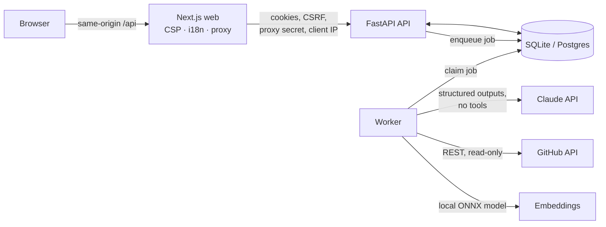

<!-- Copyright (c) 2026 Issa Jber. All rights reserved. FirstDev Platform. -->

<div align="center">


# FirstDev

**Skills you can verify, not just claim.**

A LinkedIn-inspired hiring platform for junior and mid-level developers, where every skill is checked against real code.

**Author & Creator: Issa Jber** · Copyright (c) 2026 Issa Jber. All rights reserved.

</div>

---

## Contents

- [Why FirstDev](#why-firstdev)
- [What it does](#what-it-does)
- [Architecture](#architecture)
- [The four engines](#the-four-engines)
- [Tech stack](#tech-stack)
- [Security model](#security-model)
- [Getting started](#getting-started)
- [Testing and quality](#testing-and-quality)
- [Design system](#design-system)
- [Project documents](#project-documents)
- [License](#license)

## Why FirstDev

Junior developers all send the same thing: a CV listing Python, React and Docker. Recruiters can't tell who has built something real and who has followed a tutorial. CVs are claims. Code is evidence.

FirstDev puts the evidence next to each claim:
- It parses the CV.
- It reads the developer's public GitHub repositories, without ever running them.
- It confirms skills with short timed assessments.

Recruiters get a **justified 0–100 match score** in which every point can be traced back to its source. Candidates get **specific feedback** on what to improve.

## What it does

**For developers**
- Upload a CV (PDF or text). It is parsed into skills, experience and education, and every extracted item must quote the CV word for word.
- Add GitHub repositories. Each one is analysed for languages, tests, CI, dependencies, architecture and best practices, and scored for how tutorial-like it is.
- Take timed practice assessments. Scoring 70% or more earns a **verified skill badge** that is valid for 12 months.
- See recommended jobs, a full score breakdown for each, and personal feedback. Career gaps are shown only to the developer and never affect the score.
- Connect with others and publish an opt-in public profile that shows **verified badges only**.

**For recruiters**
- Post jobs with required and optional skills.
- Get applications from **verified** candidates only (a parsed CV and at least one analysed repo), with a daily limit per candidate.
- Rank opted-in candidates and send gap-targeted assessments.
- Move applicants through a status pipeline in which every change is recorded.

**Demo mode**
- "Try as developer" or "Try as recruiter" creates a private, isolated **24-hour sandbox** cloned from a hand-written demo world: *Helix Labs*, a Tel Aviv startup with 6 developers (two with Hebrew CVs) and 4 open jobs.
- Each sandbox gets a small real-AI quota under a global daily budget, and is protected by Cloudflare Turnstile and per-IP limits.
- The whole UI is available in **English and Hebrew (right-to-left)**.

## Architecture



- **Two Python processes share one database.** The API stores a job and returns `202`. The worker claims jobs atomically, runs the pipeline, and retries only transient failures, with backoff that honours rate-limit resets.
- **The browser only talks to the Next.js origin.** The web server proxies `/api/*`, so the session cookies are first-party and CORS is never needed.
- **Every AI pipeline follows the same five steps:**
  1. Sanitize the input.
  2. Flag likely prompt injection.
  3. Wrap untrusted content in delimiters.
  4. Make a schema-constrained Claude call with no tools.
  5. Validate the output in code.
- **Deterministic facts are always computed in code, never by the model.** That covers CV gaps, repo metrics, tutorial signals and the score formula.

## The four engines

The original design called these "skills" or agents. In the product they are backend pipeline modules, each with its own spec, threat model and tests.

| Engine | What it does | Where |
|---|---|---|
| **CV-Parser** | Extracts skills, experience and education from a PDF or text CV. PDFs are parsed in an isolated subprocess with a time limit, and the raw file is never stored. Any item whose quote isn't found in the CV is dropped. Contact details are never extracted. | `src/firstdev/pipelines/cv_parser.py` |
| **Repo-Analyzer** | Reads public repos through the GitHub REST API only and never clones or runs them. It picks up to 40 files under strict caps, parses manifest dependencies in code, computes metrics and a tutorial heuristic, and asks Claude for an assessment whose every claimed file path is checked. | `src/firstdev/pipelines/repo_analyzer.py` |
| **Job-Matcher** | Narrows, then scores, then explains. Local multilingual embeddings select the 50 most relevant candidates. A deterministic formula scores all of them: **70 required + 15 optional + 15 tier**, with repo-proven or assessed skills at 1.0 credit and CV claims at 0.6. Claude reviews only the top 20: it confirms skill equivalences (checked in code), writes the reasons and feedback, and may adjust the score by at most ±10, and only with a stated reason. Results are cached until the profile or job changes. | `src/firstdev/matching/` |
| **Assessment-Gen** | Generates 6 multiple-choice and 2 short-answer questions aimed at the candidate's gaps, and checks them against strict rules. Questions and options are shuffled with a cryptographic RNG, the server enforces a 20-minute deadline, and answer keys never reach the browser before grading. Multiple choice is graded in code. Short answers are graded by Claude against rubric criteria, but the points are added up in code. | `src/firstdev/assessments/` |

## Tech stack

| Layer | Technology |
|---|---|
| API and worker | Python 3.12+ (developed on 3.14), FastAPI, SQLAlchemy 2, Alembic, Pydantic v2, uv |
| AI | Claude API (official `anthropic` SDK) with **Claude Opus 5.5** (`claude-opus-5-5`), structured outputs, server-side refusal fallbacks |
| Embeddings and vector search | `fastembed` running `paraphrase-multilingual-MiniLM-L12-v2` locally (ONNX, supports Hebrew), with float32 vectors in the main database and a numpy cosine search. Deleting an account deletes its vectors. pgvector is the planned upgrade. |
| Database | SQLite for development, with migrations written for Postgres (Cloud SQL) |
| GitHub | REST API through `httpx`, using a fixed base URL, no redirects and escaped paths |
| Web | Next.js 16 (App Router), TypeScript (strict), Tailwind CSS, next-intl (English and Hebrew right-to-left), SWR |
| Testing | pytest, respx, Vitest, Testing Library, Playwright, axe-core, Lighthouse |
| Tooling | ruff (with bandit security rules), pip-audit, npm audit, git hooks that block secrets |

**How it was built.** FirstDev was developed with Claude Code under a strict protocol:
- **Claude Opus 5.5** did the planning, architecture, threat modelling and reviews.
- **Claude Sonnet 5.5** implemented each approved plan.
- Every milestone went through the same gate: tests first, a full regression run, a security review, then a commit.

## Security model

| Threat | Defence |
|---|---|
| **Prompt injection** in CVs, repo files, job descriptions or assessment answers | <ul><li>Untrusted content is wrapped in delimiters that the content itself cannot close.</li><li>The data-only system prompts give the model **no tools**, and its output must match a fixed schema.</li><li>Evidence is verified in code: quotes must appear in the CV, file paths must exist in the repo, and skills must really be present on both sides.</li><li>Scores and points are computed in code from capped values.</li><li>Injection patterns (English, Hebrew, grading tricks) are flagged for recruiters but never rewarded.</li></ul> |
| **Malicious uploads** | Files are typed by their content, never by name. Size and page limits apply, and PDFs are parsed in a subprocess with a time limit. The request body is capped before it is parsed. |
| **SSRF** | Only `https://github.com/owner/repo` URLs are accepted, and the client only ever calls `api.github.com`. |
| **Session theft and CSRF** | <ul><li>Sessions use httpOnly cookies: an access token valid for 15 minutes and a 7-day refresh token that changes on every use. Reusing an old refresh token logs out every session in that family.</li><li>Every write made with a cookie must carry a matching CSRF token.</li><li>A strict CSP with a per-request nonce, and no `dangerouslySetInnerHTML`.</li></ul> |
| **Reading other users' data** | Every by-id read returns 404 for anything the caller doesn't own. Each sandbox is isolated in its own *world*, enforced on every cross-user query and checked by a dedicated leak test. |
| **Cost abuse** | <ul><li>Before each Claude call, its worst-case cost is reserved against a global daily budget, so the budget can't be overshot, even by parallel calls.</li><li>Each sandbox has its own quota, and sandbox creation is protected by Turnstile and per-IP limits.</li><li>Client IPs are trusted only when they come from a trusted proxy.</li></ul> |
| **Secrets and personal data** | <ul><li>Keys stay in `.env`, which is git-ignored, and a pre-commit hook blocks keys from being committed.</li><li>Logs carry ids and token counts only, never CV or answer text.</li><li>Raw IPs are stored only as salted hashes.</li><li>Deleting an account removes all of that user's data.</li></ul> |

Each part's full threat table is in its spec under [`docs/specs/`](docs/specs/).

## Getting started

**Requirements:** [uv](https://docs.astral.sh/uv/), Node.js 20+ and git. You need a Claude API key only for real AI; demo mode works without one.

```sh
git clone https://github.com/issajber30-arch/FirstDev.git
cd FirstDev
uv sync                                   # Python dependencies
npm --prefix web install                  # web dependencies
cp .env.example .env                      # then set FIRSTDEV_JWT_SECRET (>= 32 random chars)
#   optional for real AI / repo analysis: ANTHROPIC_API_KEY=...  GITHUB_TOKEN=...
```

**Run everything** (API on :8000, worker, web app on :3000):

```sh
scripts/dev.sh            # free fake-AI mode, fully interactive
scripts/dev.sh --real     # real Claude calls (counts against FIRSTDEV_LLM_DAILY_USD)
```

Open <http://localhost:3000> and click **Try as developer** or **Try as recruiter**.

**Backend only:**

```sh
uv run alembic upgrade head
uv run uvicorn firstdev.app:app --reload   # API (docs at /docs in dev)
uv run python -m firstdev.worker           # background worker
uv run python scripts/invites.py create --label "Dana"   # single-use signup code, shown once
```

**Key settings** (`FIRSTDEV_` prefix):

| Setting | Meaning |
|---|---|
| `JWT_SECRET` | required, ≥ 32 characters |
| `LLM_MODE` | `real` (default) or `fake` (canned outputs; refused in prod) |
| `LLM_DAILY_USD` | global daily Claude budget (default 5.0) |
| `REQUIRE_INVITE` | signup needs an invite code (default true) |
| `TURNSTILE_SECRET` | Cloudflare Turnstile secret for demo sandboxes |
| `TURNSTILE_DISABLED` | `true` skips Turnstile (dev only) |
| `PROXY_SECRET` | shared with the Next.js proxy; required in prod |
| `TRUSTED_PROXY_HOPS` | used by the web proxy; trusted proxies in front of Next.js (0 locally) |
| `COOKIE_PATH_PREFIX` | `/api` behind the proxy, empty for direct API access |

## Testing and quality

```sh
scripts/check.sh                 # all static checks and unit tests (list below)
scripts/web-e2e.sh --lighthouse  # Playwright on an isolated production build, then Lighthouse
uv run python scripts/e2e_smoke.py --yes --part4 --fake   # API end-to-end, free
uv run python scripts/e2e_smoke.py --yes --part3          # real Claude + GitHub, a few cents
```

`scripts/check.sh` runs copyright headers, ruff, formatting, pytest, web lint, `tsc`, Vitest, the security gates, pip-audit and npm audit.

| Layer | What it covers | Result |
|---|---|---|
| Backend unit + integration | 964 pytest tests, offline (fake LLM, fake embedder, mocked GitHub). They cover every route's rules and limits, edge cases (empty, oversized, malformed, Hebrew/RTL), golden scoring examples, migration drift, and the cross-world leak suite. | 964 passed |
| Frontend unit | 30 Vitest tests for the countdown, API wrapper (CSRF, single refresh retry), score breakdown and client-IP trust | 30 passed |
| Browser end-to-end | Playwright on the **production build**, English and Hebrew: every developer and recruiter screen, a full timed assessment, ranking, phone width, zero console errors or CSP violations | 12 / 12 |
| Accessibility | axe-core WCAG 2.1 AA on all main screens | 0 serious/critical |
| Performance | Lighthouse on the landing page | 97 / 100 / 100 |
| Live end-to-end | Real Claude Opus 5.5 + GitHub + embeddings across Parts 1–4, including injection attempts and the budget ledger | All passed |

The release process: tests are written first; every milestone ends with a full regression run and a security review; and every real run is checked against the live APIs.

## Design system

The design is dark-first and urban, inspired by night city grids and terminal interfaces. Full spec: [`docs/design-system.md`](docs/design-system.md).

| Token | Colour | Use |
|---|---|---|
| Deep Obsidian / Slate Dark | `#0B0F19` / `#111827` | backgrounds, glass cards |
| Cyber Cyan | `#00F2FE` | active states, match scores, primary actions |
| Industrial Yellow / Neon Amber | `#FFB703` | verified badges, alerts, GitHub metrics |
| Metallic Silver / Pure White | `#F8FAFC` | sharp typography |

- **Type:** Inter for the interface and JetBrains Mono for code and metrics.
- **Motifs:** glass cards with glowing neon borders and a subtle city-grid background.
- **The logo:** an **FD** monogram rising into a skyline built from code brackets (`< / >`).

## Project documents

- **Specs, each with its threat model:**
  - [Part 1: backend, CV-Parser, Repo-Analyzer](docs/specs/2026-10-17-part1-design.md)
  - [Part 2: Job-Matcher, postings, applications](docs/specs/2026-10-17-part2-design.md)
  - [Part 3: Assessment-Gen](docs/specs/2026-10-17-part3-design.md)
  - [Part 4: web sessions, demo sandboxes, social](docs/specs/2026-10-17-part4-design.md)
  - [Part 5: web frontend](docs/specs/2026-10-18-part5-design.md)
  - [Roadmap](docs/specs/2026-10-17-roadmap.md): deployment to GCP Cloud Run and portfolio polish come next.
- **Implementation plans:** [`docs/superpowers/plans/`](docs/superpowers/plans/)

## License

**Copyright (c) 2026 Issa Jber. All rights reserved.**

The source is published for viewing. It is proprietary software: no licence is granted to use, copy, modify or distribute it without written permission from the author.
